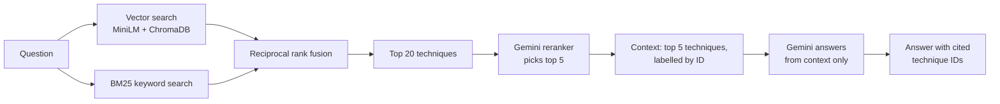

# ATT&CK Copilot

A security copilot that answers questions from MITRE ATT&CK with retrieval
augmented generation, built around an eval harness that measures every
retrieval change against a held-out test set.

Describe what you observed ("a hidden window ran an encoded command") or ask
about a technique. The copilot answers from retrieved ATT&CK passages only and
cites technique IDs.

**Headline result.** On 100 held-out test questions, the final pipeline puts
the correct technique in its top 5 for **73/100**, against **55/100** for
plain vector search (20 fixed, 2 broken, paired difference +0.18
[+0.10, +0.27], McNemar p < 0.001). The same model answering from its own
knowledge, with no retrieval, gets 43/100 (gemini-3.5-flash-lite).

- **Data:** MITRE ATT&CK Enterprise v20.1, pinned: 706 active techniques, 3,811 chunks
- **Retrieval:** vector (`all-MiniLM-L6-v2`, ChromaDB) + BM25, fused by reciprocal rank, reranked by `gemini-3.1-flash-lite`
- **Answers:** `gemini-3.1-flash-lite` behind a provider interface (Claude provider implemented, mock-tested)
- **UI:** Streamlit

Design decisions and the reasoning behind each, including what did not work,
are in [docs/design.md](docs/design.md). Per-question error analysis is in
[docs/error_analysis.md](docs/error_analysis.md).

## Architecture



Chunks are technique descriptions, detection guidance (from ATT&CK detection
strategies) and procedure examples (how real groups and malware used the
technique, from STIX `uses` relationships).

## Results

### Evaluation set

333 questions, each mapped to one correct technique ID:

- an **independent set**: 25 questions written independently by a different
  model, without access to the indexed corpus, then ID-checked against the
  pinned ATT&CK release;
- a **generated set**: 308 questions generated by `gemini-3.1-flash-lite`
  from technique text, one technique each, with a check that rejects any
  question naming its technique.

Split 233 dev / 100 test, stratified by set. All tuning and selection used dev
only. The test split was run once for the baseline and once for the final
configuration, which was chosen by a rule committed before its dev result was
known (see [docs/design.md](docs/design.md#evaluation)).

**Metrics.** Results are reduced to distinct techniques. *hit rate@5*: the
correct technique is among the top 5, which is exactly the context the model
answers from. *MRR@5*: mean of 1/rank within the top 5. *Parent level*: a
sibling in the same family counts (`T1059.003` for `T1059.001`). Rates carry
95% bootstrap intervals; pipelines are compared **question by question**
against the baseline: *fixed* (baseline wrong, pipeline right), *broke* (the
reverse), an exact McNemar test, and a paired bootstrap interval on the
difference.

### Test split (held out, run once per configuration)

| Pipeline | Set | hit rate@5 [95% CI] | MRR@5 [95% CI] | hit rate@5, parent level |
|---|---|---|---|---|
| Vector search (baseline) | all | 55/100 (0.550) [0.450, 0.650] | 0.376 [0.295, 0.459] | 72/100 (0.720) |
| Vector search (baseline) | independent set | 4/8 (0.500) [0.125, 0.875] | 0.375 [0.125, 0.688] | 4/8 (0.500) |
| Vector search (baseline) | generated set | 51/92 (0.554) [0.457, 0.652] | 0.376 [0.291, 0.464] | 68/92 (0.739) |
| **Final pipeline** | **all** | **73/100 (0.730) [0.640, 0.820]** | **0.604 [0.520, 0.691]** | 88/100 (0.880) |
| Final pipeline | independent set | 7/8 (0.875) [0.625, 1.000] | 0.875 [0.625, 1.000] | 7/8 (0.875) |
| Final pipeline | generated set | 66/92 (0.717) [0.620, 0.804] | 0.581 [0.492, 0.670] | 81/92 (0.880) |

Paired against the baseline on the same 100 questions:

| Set | Fixed | Broke | Difference [paired 95% CI] | McNemar p |
|---|---:|---:|---|---:|
| all | 20 | 2 | +0.180 [+0.100, +0.270] | 0.0001 |
| independent set | 3 | 0 | +0.375 [+0.125, +0.750] | 0.25 |
| generated set | 17 | 2 | +0.163 [+0.076, +0.250] | 0.0007 |

The independent set improves too, but at 8 questions it cannot reach
significance on its own.

### Every change, on dev (including the ones that made things worse)

Each row is paired against the vector baseline (112/233) on the same 233
dev questions.

| Pipeline | hit@5 | MRR@5 | Fixed | Broke | Difference [paired 95% CI] | McNemar p |
|---|---|---|---:|---:|---|---:|
| Vector search, MiniLM (baseline) | 112/233 (0.481) | 0.341 | | | | |
| Vector, description chunks only | 107/233 (0.459) | 0.310 | 17 | 22 | −0.021 [−0.073, +0.030] | 0.52 |
| + BM25 hybrid (RRF) | 117/233 (0.502) | 0.327 | 28 | 23 | +0.021 [−0.039, +0.082] | 0.58 |
| + BM25 hybrid + cross-encoder reranker | 119/233 (0.511) | 0.299 | 30 | 23 | +0.030 [−0.030, +0.090] | 0.41 |
| Vector + procedure examples | 115/233 (0.494) | 0.348 | 4 | 1 | +0.013 [−0.004, +0.034] | 0.38 |
| BM25 hybrid + procedure examples | 126/233 (0.541) | 0.352 | 31 | 17 | +0.060 [+0.000, +0.120] | 0.059 |
| **+ Gemini reranker (final)** | **171/233 (0.734)** | **0.613** | **65** | **6** | **+0.253 [+0.189, +0.318]** | **<0.001** |
| Same, reranked by gemini-3.5-flash-lite¹ | 178/233 (0.764) | 0.621 | 69 | 3 | +0.283 [+0.219, +0.343] | <0.001 |
| Vector search, bge-small-en-v1.5 | 76/233 (0.326) | 0.203 | 15 | 51 | −0.155 [−0.223, −0.090] | <0.001 |
| bge-small + BM25 hybrid + cross-encoder | 97/233 (0.416) | 0.269 | 23 | 38 | −0.064 [−0.129, +0.000] | 0.072 |

¹ Run after the test split, so reported as an observation, not a selection.

What mattered:

- **The LLM reranker is the only large win.** Against hybrid + procedure
  examples it fixes 51 dev questions and breaks 6. Most misses were ranking
  misses, not retrieval misses: vector search had the right technique in its
  top 50 for 205/233 dev questions but in its top 5 for only 112.
- **Procedure examples help only with BM25.** On their own they change 5
  questions; with BM25 they give the best non-LLM pipeline, because they name
  the tools and commands BM25 matches on.
- **The cross-encoder churns without helping.** It fixes 30 and breaks 23,
  and MRR@5 drops. No input was truncated; it is a web-search model that
  cannot tell sibling ATT&CK techniques apart.
- **bge-small is significantly worse than MiniLM here.** Its setup was
  checked (query instruction on queries only, cosine, unit vectors, same
  chunks, own model per collection). Without the instruction it scores
  82/233.

Full per-set tables: `scripts/results_table.py`. Notes: a cross-encoder bug
(re-scoring every fetched chunk instead of the top N) was fixed during
Phase 4; the pre-fix figure of 113/233 is superseded.

### How close to the ceiling

The reranker can only choose from its top-20 shortlist.

| Split | Correct technique in the shortlist | Final hit@5 | Share of the reachable ceiling |
|---|---|---|---|
| Dev | 185/233 (0.794) | 171/233 (0.734) | 92% |
| Test | 76/100 (0.760) | 73/100 (0.730) | 96% |

The remaining errors are mostly first-stage retrieval misses; further gains
have to come from retrieval, not reranking.

### The deployed app's measured score

The app ships a prebuilt index (see [Deployment](#deployment)) rather than
the index the evals were run on. Approximate nearest-neighbour search builds a
slightly different graph each time, so the shipped index was scored on its
own: the final pipeline on the 233 dev questions, with the evaluation index
removed and only the shipped snapshot loaded, as on Streamlit Cloud.

| Index | hit@5 | MRR@5 |
|---|---|---|
| Evaluated index | 171/233 (0.734) | 0.613 |
| **Shipped snapshot (deployed app)** | **171/233 (0.734)** | **0.615** |

Paired, question by question: 0 fixed, 0 broken. The top 5 differ in order
for 26 questions, but no question changes between hit and miss
(`results/shipped/`).

### Cost and latency of the reranker

Measured on 20 uncached dev questions (`results/llm_rerank_cost_dev.json`):

| | Per question |
|---|---|
| Hybrid search (first stage) | 0.07 s median |
| Gemini rerank call | 1.14 s median, 1.62 s p90 (retries excluded) |
| Tokens | 853 input, 43 output |
| Cost at $0.25 / $1.50 per 1M tokens | $0.00028 (about $0.28 per 1,000 questions) |

Answering a question in the app makes one more LLM call (the answer itself), which is not included above.

### RAG against the model's own knowledge (test split)

Each model names its top 5 technique IDs with no retrieval, paired against
the final pipeline on the same 100 test questions. *Invalid*: ID not in
ATT&CK v20.1. *Retired*: revoked or deprecated. *Stale*: a retired ID whose
successor is the correct answer.

| | hit@5 | vs final pipeline: fixed / broke | Difference [paired 95% CI] | McNemar p | Invalid IDs | Retired IDs (questions) | Stale answers |
|---|---|---|---|---:|---|---|---|
| **Final pipeline** | **73/100** | | | | 0 | 0 | 0 |
| Closed book, gemini-3.5-flash-lite | 43/100 | 10 / 40 | −0.300 [−0.420, −0.170] | <0.001 | 1 of 496 | 17 of 496 (14 questions) | 1 |
| Closed book, gemini-3.1-flash-lite | 39/100 | 6 / 40 | −0.340 [−0.450, −0.220] | <0.001 | 1 of 500 | 14 of 500 (9 questions) | 2 |

Detail for gemini-3.5-flash-lite (`results/closed_book_gemini-3.5-flash-lite_test.json`; the 3.1 file
has the same fields):

- **Invalid:** `T1636.002`, a Mobile ATT&CK ID given for an Enterprise question.
- **Retired**, all revoked: `T1562.001` ×7 (now `T1685` Disable or Modify Tools), `T1574.002` ×5 (now
  `T1574.001` DLL), `T1562.004` ×2 (now `T1686` Disable or Modify System Firewall), `T1562` ×2 (now
  `T1685`), `T1656` ×1 (now `T1684.001` Impersonation).
- **Stale:** independent-set question i012 (stopping the endpoint agent's service), where the answer is
  `T1685` and the model's first choice was `T1562.001`, its revoked predecessor. Only two test
  questions target a renumbered technique (i012 and g124), so the recent-techniques slice below
  tests this properly.

The pipeline cannot return an invalid or retired ID: it only selects from an
index of active techniques.

### Techniques added or renumbered in ATT&CK v19 and v20

"Added or renumbered in the last two releases" means active in v20.1 but not
in v18.1, the last release before v19: 32 techniques. 15 are new IDs for
revoked ones (for example `T1562.001` Disable or Modify Tools became `T1685`),
and 17 are new techniques, many about AI systems (prompt injection, AI result
poisoning). Only 6 test questions target them, so a separate slice has one
generated question per technique (`data/eval/recent_questions.jsonl`), never
used for tuning or selection.

| | Renumbered (15) | New (17) | All (32) | Stale answers | Questions with a retired ID |
|---|---|---|---|---|---|
| **Final pipeline** | **14/15** | **9/17** | **23/32 (0.719)** | 0 | 0 |
| Closed book, gemini-3.1-flash-lite | 0/15 | 0/17 | 0/32 | 5 | 14 |
| Closed book, gemini-3.5-flash-lite | 0/15 | 0/17 | 0/32 | 8 | 20 |

Paired against the pipeline, each closed-book model fixes 0 and breaks 23
(difference −0.719 [−0.875, −0.562], McNemar p < 0.001). On the 6 test
questions that target these techniques: pipeline 4/6, both closed-book
models 0/6.

- **Renumbered techniques:** the models often know the technique but answer
  with its old ID. gemini-3.5-flash-lite gave a revoked ID whose successor was
  correct on 8 of 15 renumbered questions, 3.1 on 5. Because exact IDs are
  scored, those count as misses, and in a real tool they would point an
  analyst to a retired page.
- **New techniques:** the models fall back to the nearest older technique,
  e.g. `T1027.010` Command Obfuscation for `T1027.018` Invisible Unicode. The
  pipeline finds 9 of 17. It misses 8, most of them broad AI-related
  techniques (Query Public AI Services, Generate Content and its two
  sub-techniques, Direct Prompt Injection, AI-Enabled Exfiltration), plus
  Social Engineering and Impair Autonomous Defenses.
- The models' training predates these releases, so this measures freshness
  as much as skill: it is the case where retrieval over a current corpus
  matters most.

### Self-generation check

The generated set was written by the model that also reranks. If it favoured
its own questions, the generated-vs-independent gap would shrink with a
different reranker. It did not (dev):

| Reranker | Generated set | Independent set | Gap |
|---|---|---|---|
| None (hybrid + procedure examples) | 114/216 (0.528) | 12/17 (0.706) | −0.18 |
| gemini-3.1-flash-lite (wrote the generated set) | 155/216 (0.718) | 16/17 (0.941) | −0.22 |
| gemini-3.5-flash-lite | 162/216 (0.750) | 16/17 (0.941) | −0.19 |

3.5 does better than 3.1 on the questions 3.1 wrote (8 fixed, 1 broken). With
17 independent dev questions this is a weak test, and a Claude reranker was
not run.

## Limitations

- The independent set is small: 25 questions, 8 in test.
- All 333 questions were written by LLMs: 308 by gemini-3.1-flash-lite from
  the indexed technique text, and 25 (the independent set) by a different
  model without access to the corpus. The independent set is also easier:
  every pipeline scores higher on it on dev (on test, with only 8
  questions, the baseline does not), likely because it covers well-known
  techniques.
- Many remaining misses are parent/sub-technique granularity: the answer is
  `T1059.003` and the top choice is `T1059`, or the reverse.
- About a quarter of test questions never reach the reranker's shortlist.
- Free-tier Gemini quotas (15 requests a minute, 500 a day per model) limit
  eval speed and how many people the demo can serve.
- The Claude provider is implemented and mock-tested only; no Claude results
  are reported.

## Run it

Requires Python 3.13 and [uv](https://docs.astral.sh/uv/).

```
uv sync
copy .env.example .env          # then add GEMINI_API_KEY
.venv\Scripts\python scripts\ingest.py --corpus procedures
.venv\Scripts\python -m streamlit run app.py
```

Evals (results are written to `results/`; Gemini responses are cached in
`data/cache/`, so re-runs make no API calls):

```
.venv\Scripts\python scripts\eval_retrieval.py --retriever hybrid_proc_llm --split dev
.venv\Scripts\python scripts\paired_compare.py --split dev
.venv\Scripts\python scripts\results_table.py
.venv\Scripts\python -m pytest
```

## Deployment

The public demo runs on Streamlit Community Cloud.

- **Prebuilt index.** `data/index/attack-v20.1-minilm-procedures.npz` (5.9 MB)
  holds the chunks, their vectors and the reranker's catalog, so the app
  loads the index in seconds and embeds nothing at startup.
- **Separate API key.** The demo uses its own Gemini key, set as the
  `GEMINI_API_KEY` secret in Streamlit, never the key used for evals.
- **Quota limits.** 10 questions per browser session and 100 per day across
  all visitors, well under the free tier's 500 daily requests (each question
  makes two calls). When a limit is reached the input is disabled with an
  explanation.

To deploy your own copy: fork the repo, create an app at share.streamlit.io
with `app.py` as the main file and Python 3.13, and add `GEMINI_API_KEY` under
Secrets.

## LLM providers

`LLM_PROVIDER` in `.env` selects the vendor.

| Provider | Model | Status |
|---|---|---|
| Gemini | `gemini-3.1-flash-lite` | Default; all results above |
| Claude | `claude-haiku-5-5` | Implemented, mock-tested; not run against the real API |
