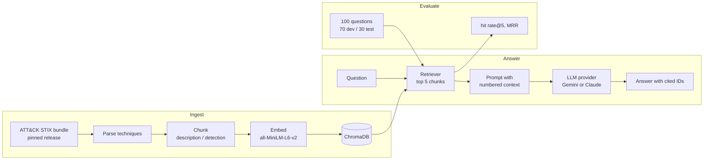

# Design

A security copilot that answers questions from MITRE ATT&CK, with an eval
harness that measures every retrieval change. This document records how it is
built and why each choice was made.

## Goals

- Answers come only from retrieved ATT&CK passages and cite technique IDs.
- Retrieval quality is measured (hit rate@5, MRR) at baseline and after each
  improvement.
- The RAG pipeline is compared against the same model with no retrieval.
- Every reported number is produced by a script in this repo and stored in
  `results/`.

Out of scope: the Mobile and ICS matrices, groups, software, mitigations,
multi-turn memory, user accounts, fine-tuning.

## Architecture

| Module | Responsibility |
|---|---|
| `copilot/config.py` | Pinned versions, model IDs, paths; reads secrets from the environment |
| `copilot/attack.py` | Download a release; parse active techniques; revoked-ID lookups |
| `copilot/chunking.py` | Technique to retrieval chunks |
| `copilot/index.py` | Build and query the ChromaDB collection |
| `copilot/retrieval.py` | Named retrievers with one signature: `(query, k) -> chunks` |
| `copilot/llm.py` | One provider interface; Gemini and Claude implementations |
| `copilot/rag.py` | Retrieve, build the prompt, answer, extract citations |
| `copilot/evals/` | Question set, validation, split, metrics, runner, question generation |
| `scripts/` | Thin command-line entry points |
| `app.py` | Streamlit chat UI |

The package holds the logic; scripts and the app only call it. The eval
harness and the app therefore run the same retrieval code, so the measured
numbers describe the shipped system.

A framework such as LangChain was not used. It would hide chunking, fusion
and prompting behind defaults, and those are the decisions this project is
about.

## Data

**Pinned release.** `ATTACK_VERSION` is fixed at 20.1. Each ATT&CK release
adds and revokes techniques; reading "latest" would change the answer key
under the evals without any code change.

**Active techniques only.** Of 867 technique objects, 161 are revoked or
deprecated. They are not indexed, because citing one would be a wrong answer.
706 remain: 227 techniques and 479 sub-techniques.

**Detection text comes from detection strategies.** From ATT&CK v18 the
`x_mitre_detection` field on techniques is empty. Detection guidance moved to
`x-mitre-detection-strategy` objects, linked to a technique by a `detects`
relationship, each listing `x-mitre-analytic` objects with per-platform text.
The parser follows those links and falls back to the legacy field so older
bundles still parse. Reading only the legacy field would index no detection
content at all.

**Markup is stripped.** `(Citation: ...)` markers, `<code>` tags and Markdown
link syntax add tokens without adding meaning.

## Chunking

- **Description and detection are separate chunks.** "What is this?" and "how
  do I detect it?" are different questions; one mixed chunk has a blurrier
  embedding for both.
- **Every chunk starts with a header**: `T1059.001 PowerShell (tactics:
  execution)`. A piece cut from the middle of a long description still says
  what it is about, and the LLM always sees the ID it must cite.
- **800-character cap.** The embedding model reads at most 256 tokens and
  silently discards the rest. At 800 characters, 3 of 2,472 chunks exceed the
  window, by at most 18 tokens.
- **Split on paragraph boundaries.** Paragraphs are packed whole up to the
  cap. Overlap (120 characters) is applied only when a single paragraph is
  longer than the cap and must be cut mid-text; paragraph ends are natural
  topic breaks and need none.

Result: 2,472 chunks (1,508 description, 964 detection).

## Index

- **ChromaDB**, persisted to disk, cosine distance.
- **`all-MiniLM-L6-v2` embeddings**: small enough to run on a free CPU host,
  fast enough to index everything in about two minutes.
- **Embeddings are computed by this code and passed to ChromaDB** rather than
  by ChromaDB's built-in embedder, so indexing, search and evals share one
  model object and cannot drift apart.
- **The index is rebuilt from scratch on every ingest**, so chunks from an
  earlier chunking setting never linger.

## Answering

- **Top 5 chunks in the prompt, each labelled with its technique ID.** The
  system prompt requires answering only from the context, citing those IDs in
  square brackets, and saying so when the context does not cover the question.
  Passages were first numbered `[1]`..`[5]`; the model then cited the numbers
  instead of technique IDs, so the label was changed to the ID itself.
- **Temperature 0**, so the same question and context give the same answer.
- **Citations are filtered to retrieved IDs.** A technique the model cites
  that was not in the context cannot have come from the context, and is not
  shown as a grounded citation.
- **The retriever is injected as a function.** Vector search, hybrid search
  and the reranker plug into the same answer code.

## LLM providers

All model calls go through one interface, `generate(system, prompt,
temperature)`. `LLM_PROVIDER=gemini|claude` selects the implementation; no
other module imports a vendor library.

| Provider | Model (pinned) | Status |
|---|---|---|
| Gemini | `gemini-3.1-flash-lite` | Default |
| Claude | `claude-haiku-5-5` | Implemented, mock-tested; not yet run against the real API |

`gemini-3.1-flash-lite` was the cheapest Flash-family model open to new API
keys on 2026-11-17 ($0.25 input / $1.50 output per 1M tokens). The cheaper
`gemini-2.5-flash-lite` is listed on the pricing page but closed to new
users. Google lists a shutdown date of 2027-05-07 for 3.1 and names
`gemini-3.5-flash-lite` as its replacement; switching is a one-line change in
`copilot/config.py`.

The Claude provider calls the Messages API over plain HTTP with `httpx`
rather than the vendor SDK. The SDK depends on a compiled module that Windows
Smart App Control blocked intermittently on the development machine, and the
API is a single POST request.

## Evaluation

**Question set.** 333 questions, each mapped to one technique ID: an
*independent set* of 25 questions written independently by a different
model, without access to the indexed corpus, then ID-checked against the
pinned ATT&CK release; and a *generated set* of 308 written by
`gemini-3.1-flash-lite` from technique text (sampled in turn across tactics
with a fixed seed, one technique per question, excluding techniques the
independent set covers). Scores are reported for each set separately.
Generated questions are written from the same text that is indexed and may
echo its wording; the independent set is the stricter test, but at 25
questions it is small.

**Validation before every run.** The eval refuses to start if any answer-key
ID is revoked, deprecated or unknown in the pinned release, or if a question
names its technique or ID. A revoked ID is never indexed, so such a question
would silently score as a miss. Two independent-set questions originally used
IDs that MITRE revoked (`T1070.001` to `T1685.005`, `T1562.001` to `T1685`);
they were remapped using the bundle's `revoked-by` relationships, with the
original ID kept in a note field.

**70 / 30 split: 233 dev, 100 test**, stratified by set. All tuning and
pipeline selection use dev. The vector baseline was run on test once, when
the set was built; the final configuration is run on test once, at the end.
Membership comes from a hash of a fixed seed and the question ID, so it does
not depend on file order.

**Metrics.** Retrieval returns chunks; they are reduced to distinct
techniques in order of first appearance, and both metrics look at the top 5
of those. The answer pipeline builds its context from the same 5 techniques,
so the metric describes what the model is shown.

- *hit rate@5*: the correct technique is among the top 5 techniques.
- *MRR@5*: mean of 1 / rank of the correct technique within the top 5, 0 if
  it is not there.
- Both are also reported at parent level, where `T1059.001` and `T1059`
  count as the same family. Exact is the headline; parent level shows how
  many misses are near misses.
- Each rate has a 95% percentile bootstrap interval over questions.

**Comparing pipelines.** Two pipelines run on the same questions are paired
samples, so overlapping confidence intervals are not the test. Each pipeline
is compared with the vector baseline question by question: how many
questions it *fixed* (baseline wrong, pipeline right) and *broke* (the
reverse), an exact McNemar test on those discordant questions, and a paired
bootstrap 95% interval on the difference in hit@5
(`scripts/paired_compare.py`).

**Choosing the final configuration.** This rule was fixed on 2026-11-18,
before the Gemini reranker's dev result was known, and before the final test
run.

1. The candidate to beat is *BM25 hybrid + procedure examples*, the best
   pipeline on dev without an LLM in the retrieval loop (126/233, against
   112/233 for the vector baseline; 31 fixed, 17 broken, McNemar p = 0.059).
2. The final configuration is *BM25 hybrid + procedure examples + Gemini
   reranker* only if, in a paired dev comparison against step 1's
   candidate, it fixes more questions than it breaks **and** the paired 95%
   interval on the difference in hit@5 is entirely above zero.
3. Otherwise the final configuration is *BM25 hybrid + procedure examples*.
4. The Gemini reranker's cost and latency per question are reported either
   way.
5. The test split is then run once on the final configuration and reported
   paired against the vector baseline on the same 100 test questions. No
   setting is changed after seeing the test result.

**Rate limits.** The Gemini provider waits and retries on HTTP 429, because
the free tier allows 15 requests a minute and eval runs make 100 or more.

## Secrets

API keys are read from environment variables, loaded from a git-ignored
`.env` file in development. `.env.example` lists the names with no values.
