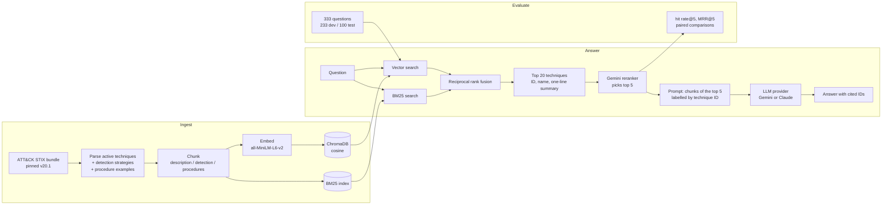

# Design

A security copilot that answers questions from MITRE ATT&CK, with an eval
harness that measures every retrieval change. This document records how it is
built and why each choice was made, including the choices that did not work.

## Goals

- Answers come only from retrieved ATT&CK passages and cite technique IDs.
- Retrieval quality is measured (hit rate@5, MRR@5) at baseline and after each
  change, and changes are compared question by question.
- The RAG pipeline is compared against the same model family with no retrieval.
- Every reported number is produced by a script in this repo and stored in
  `results/`.

Out of scope: the Mobile and ICS matrices, groups, software, mitigations,
multi-turn memory, user accounts, fine-tuning.

## Architecture

| Module | Responsibility |
|---|---|
| `copilot/config.py` | Pinned versions, model IDs, tuned settings, paths; reads secrets from the environment |
| `copilot/attack.py` | Download a release; parse active techniques, detection text and procedure examples; revoked-ID lookups |
| `copilot/chunking.py` | Technique to retrieval chunks |
| `copilot/index.py` | Build and query the ChromaDB collections (one per embedding model and chunk set) |
| `copilot/retrieval.py` | BM25, rank fusion, cross-encoder, named pipelines with one signature: `(query, k) -> chunks` |
| `copilot/llm_rerank.py` | LLM reranking over a technique shortlist, with an on-disk response cache |
| `copilot/llm.py` | One provider interface; Gemini and Claude implementations; retries and timeouts |
| `copilot/rag.py` | Retrieve, choose context, build the prompt, answer, extract citations |
| `copilot/evals/` | Question sets, validation, split, metrics, paired tests, runner, closed-book baseline |
| `copilot/sysmem.py` | Free-memory guard for long eval runs |
| `scripts/` | Thin command-line entry points |
| `app.py` | Streamlit chat UI |

The package holds the logic; scripts and the app only call it. The eval
harness and the app therefore run the same retrieval code, so the measured
numbers describe the shipped system.

A framework such as LangChain was not used. It would hide chunking, fusion
and prompting behind defaults, and those are the decisions this project is
about.

## Data

**Pinned release.** `ATTACK_VERSION` is fixed at 20.1. Each ATT&CK release
adds and revokes techniques; reading "latest" would change the answer key
under the evals without any code change.

**Active techniques only.** Of 867 technique objects, 161 are revoked or
deprecated. They are not indexed, because citing one would be a wrong answer.
706 remain: 227 techniques and 479 sub-techniques.

**Detection text comes from detection strategies.** From ATT&CK v18 the
`x_mitre_detection` field on techniques is empty. Detection guidance moved to
`x-mitre-detection-strategy` objects, linked to a technique by a `detects`
relationship, each listing `x-mitre-analytic` objects with per-platform text.
The parser follows those links and falls back to the legacy field so older
bundles still parse. Reading only the legacy field would index no detection
content at all.

**Procedure examples come from `uses` relationships.** A `uses` relationship
from a group, campaign or piece of software to a technique carries a sentence
on how it was used in a real intrusion ("Emotet has used PowerShell to ...").
619 of 706 techniques have at least one; 17,636 in total.

**Markup is stripped.** `(Citation: ...)` markers, `<code>` tags and Markdown
link syntax add tokens without adding meaning.

## Chunking

- **Description, detection and procedure examples are separate chunks.**
  "What is this?", "how do I detect it?" and "how has it been used?" are
  different questions; one mixed chunk has a blurrier embedding for each.
- **Every chunk starts with a header**: `T1059.001 PowerShell (tactics:
  execution)`. A piece cut from the middle of a long description still says
  what it is about, and the LLM always sees the ID it must cite.
- **800-character cap.** The embedding model reads at most 256 tokens and
  silently discards the rest. At 800 characters, 5 of 3,811 chunks exceed the
  window, by at most 51 tokens.
- **Split on paragraph boundaries.** Paragraphs are packed whole up to the
  cap. Overlap (120 characters) is applied only when a single paragraph is
  longer than the cap and must be cut mid-text; paragraph ends are natural
  topic breaks and need none.
- **At most four procedure chunks per technique.** A few common techniques
  have hundreds of examples (Ingress Tool Transfer has 531) and would otherwise flood the
  index and crowd out rarer techniques.

Result: 3,811 chunks (1,508 description, 964 detection, 1,339 procedure).

## Index

- **ChromaDB**, persisted to disk, cosine distance.
- **`all-MiniLM-L6-v2` embeddings**: small enough to run on a free CPU host,
  fast enough to index everything in about three minutes.
- **Embeddings are computed by this code and passed to ChromaDB** rather than
  by ChromaDB's built-in embedder, so indexing, search and evals share one
  model object and cannot drift apart.
- **One collection per embedding model and chunk set**, so variants can be
  compared side by side. Each is rebuilt from scratch on ingest, so chunks
  from an earlier setting never linger. `scripts/check_indexes.py` verifies
  that each collection holds exactly the current chunks, was built with its
  own model, stores unit-length vectors and reports 1 − cosine as distance.

## Retrieval

The shipped pipeline has three stages.

1. **Vector search and BM25 keyword search**, 20 chunks each. Embeddings
   blur exact terms; BM25 matches tool names, commands, event IDs and ports.
2. **Reciprocal rank fusion** (k = 10) merges the two lists using ranks
   only, so cosine scores and BM25 scores, which are on different scales,
   never need normalising.
3. **Gemini reranker.** The top 20 distinct techniques go to
   `gemini-3.1-flash-lite` as ID, name and the first sentence of the
   description, with the question. It returns its top 5 in order. Responses
   are cached on disk by model and prompt, so evals re-run for free.

**Tuned on dev only.** Fusion depth (20/50/100) and k (10/60) were searched
on the dev split (`scripts/tune_retrieval.py`, `results/tuning_dev.json`).
k = 10 beat the paper's default of 60 at every depth, and deeper lists
did worse (my reading, not tested: deeper lists let in more weak BM25
matches).

**Why it works: most misses were ranking misses.** For vector search on dev,
the correct technique was in the top 50 for 205/233 questions but in the top
5 for only 112. The problem was ordering, not finding, which is what a
reranker fixes. The Gemini reranker gets 92% of the way to its ceiling on
dev and 96% on test: the correct technique is in its top-20 shortlist for
185/233 dev and 76/100 test questions.

**What did not work, and why** (all measured on dev, kept in the results):

- *Cross-encoder reranker* (`ms-marco-MiniLM-L-6-v2`): 119/233, +7 over the
  baseline but MRR@5 fell, and it fixed 30 questions while breaking 23. No
  input was truncated (longest pair 306 of 512 tokens). It is trained on web
  search queries and cannot tell sibling ATT&CK techniques apart. A bug where
  it re-scored every fetched chunk instead of the top N was found and fixed;
  the earlier figure (113/233) is superseded.
- *bge-small-en-v1.5 embeddings*: 76/233, significantly worse than MiniLM
  (15 fixed, 51 broken, p < 0.001). Checked and ruled out: the query
  instruction is applied to queries only; both collections use cosine with
  unit vectors; both hold identical chunks, each searched with its own model.
  Without the instruction it scores 82/233. The eval questions are
  two-sentence scenarios, closer to passages than to short search queries,
  which may suit MiniLM's paraphrase training better (not tested further).
- *Description chunks only*: 107/233. Detection chunks are not noise: only
  18 of 964 are near-empty and 40 consist only of lines shared with another
  technique.
- *BM25 hybrid without procedure examples*: 117/233, 28 fixed and 23 broken;
  not distinguishable from the baseline.

## Answering

- **Context is the top 5 techniques, up to two chunks each**, not the top 5
  raw chunks. One technique cannot fill every slot with its own chunks, and
  the eval metric (hit@5 over distinct techniques) describes exactly what the
  model is shown. Two chunks let both description and detection through.
- **Each passage is labelled with its technique ID.** The system prompt
  requires answering only from the context, citing those IDs in square
  brackets, and saying so when the context does not cover the question.
  Passages were first numbered `[1]`..`[5]`; the model then cited the numbers
  instead of technique IDs, so the label was changed to the ID itself.
- **Temperature 0**, so the same question and context give the same answer.
- **Citations are filtered to retrieved IDs.** A technique the model cites
  that was not in the context cannot have come from the context, and is not
  shown as a grounded citation.

## LLM providers

All model calls go through one interface, `generate(system, prompt,
temperature)`. `LLM_PROVIDER=gemini|claude` selects the implementation; no
other module imports a vendor library.

| Provider | Model (pinned) | Status |
|---|---|---|
| Gemini | `gemini-3.1-flash-lite` | Default; all results |
| Claude | `claude-haiku-5-5` | Implemented, mock-tested; not run against the real API |

`gemini-3.1-flash-lite` was the cheapest Flash-family model open to new API
keys on 2026-11-17 ($0.25 input / $1.50 output per 1M tokens). The cheaper
`gemini-2.5-flash-lite` is listed on the pricing page but closed to new
users. Google lists a shutdown date of 2027-05-07 for 3.1 and names
`gemini-3.5-flash-lite` as its replacement; switching is a one-line change in
`copilot/config.py`.

**Retries and timeouts.** Requests time out after 120 seconds. Rate limits
(429), overload (503), internal errors (500), server deadlines (504) and
client timeouts are retried after 15, 30, 60 and 60 seconds. Each of these
stopped a long eval run at least once before it was handled. Timeouts are
matched by type name, because google-genai raises them from its own bundled
copy of httpx rather than from `httpx`.

The Claude provider calls the Messages API over plain HTTP with `httpx`
rather than the vendor SDK. The SDK depends on a compiled module that Windows
Smart App Control blocked intermittently on the development machine, and the
API is a single POST request.

## Evaluation

**Question set.** 333 questions, each mapped to one technique ID: an
*independent set* of 25 questions written independently by a different
model, without access to the indexed corpus, then ID-checked against the
pinned ATT&CK release; and a *generated set* of 308 written by
`gemini-3.1-flash-lite` from technique text (sampled in turn across tactics
with a fixed seed, one technique per question, excluding techniques the
independent set covers). Scores are reported for each set separately.
Generated questions are written from the same text that is indexed and may
echo its wording; the independent set is the stricter test, but at 25
questions it is small.

**Validation before every run.** The eval refuses to start if any answer-key
ID is revoked, deprecated or unknown in the pinned release, or if a question
names its technique or ID. A revoked ID is never indexed, so such a question
would silently score as a miss. Two independent-set questions originally used
IDs that MITRE revoked (`T1070.001` to `T1685.005`, `T1562.001` to `T1685`);
they were remapped using the bundle's `revoked-by` relationships, with the
original ID kept in a note field.

**70 / 30 split: 233 dev, 100 test**, stratified by set. All tuning and
pipeline selection use dev. The vector baseline was run on test once, when
the set was built; the final configuration is run on test once, at the end.
Membership comes from a hash of a fixed seed and the question ID, so it does
not depend on file order.

**Metrics.** Retrieval returns chunks; they are reduced to distinct
techniques in order of first appearance, and both metrics look at the top 5
of those. The answer pipeline builds its context from the same 5 techniques,
so the metric describes what the model is shown.

- *hit rate@5*: the correct technique is among the top 5 techniques.
- *MRR@5*: mean of 1 / rank of the correct technique within the top 5, 0 if
  it is not there.
- Both are also reported at parent level, where `T1059.001` and `T1059`
  count as the same family. Exact is the headline; parent level shows how
  many misses are near misses.
- Each rate has a 95% percentile bootstrap interval over questions.

**Comparing pipelines.** Two pipelines run on the same questions are paired
samples, so overlapping confidence intervals are not the test. Each pipeline
is compared with the vector baseline question by question: how many
questions it *fixed* (baseline wrong, pipeline right) and *broke* (the
reverse), an exact McNemar test on those discordant questions, and a paired
bootstrap 95% interval on the difference in hit@5
(`scripts/paired_compare.py`).

**Choosing the final configuration.** This rule was fixed on 2026-11-18,
before the Gemini reranker's dev result was known, and before the final test
run.

1. The candidate to beat is *BM25 hybrid + procedure examples*, the best
   pipeline on dev without an LLM in the retrieval loop (126/233, against
   112/233 for the vector baseline; 31 fixed, 17 broken, McNemar p = 0.059).
2. The final configuration is *BM25 hybrid + procedure examples + Gemini
   reranker* only if, in a paired dev comparison against step 1's
   candidate, it fixes more questions than it breaks **and** the paired 95%
   interval on the difference in hit@5 is entirely above zero.
3. Otherwise the final configuration is *BM25 hybrid + procedure examples*.
4. The Gemini reranker's cost and latency per question are reported either
   way.
5. The test split is then run once on the final configuration and reported
   paired against the vector baseline on the same 100 test questions. No
   setting is changed after seeing the test result.

**Outcome.** The reranker fixed 51 dev questions and broke 6 against the
candidate, paired interval [+0.133, +0.253], so it was selected
(`results/selection_dev.json`). A rerun with `gemini-3.5-flash-lite` as the
reranker scored higher on dev (178/233 against 171/233) after the test split
had been run; it is reported as an observation only, since choosing it then
would be selecting on information gathered after the test run.

**Repeatability.** A second dev run in a fresh process gave the same score
(171/233). Eleven questions came back with a slightly different top 5,
because near-tied first-stage candidates can swap order between processes;
none changed between hit and miss.

**Self-generation check.** The generated set was written by the same model
that reranks. If that model favoured its own questions, the gap between the
generated set and the independent set would shrink with a different
reranker. It did not: the gap was −0.18 with no LLM reranker, −0.22 with 3.1
and −0.19 with 3.5, and 3.5 did better than 3.1 on the generated set (8
fixed, 1 broken). With 17 independent dev questions this is a weak test, and
the Claude reranker was not run (no API key).

**Closed-book comparison.** Each model is asked for its top 5 technique IDs
from its own knowledge, with no retrieval, and is scored like the pipeline.
It also counts the failure modes retrieval prevents: *invalid* IDs (not in
v20.1), *retired* IDs (revoked or deprecated), and *stale* answers (a retired
ID whose successor is the correct answer). The pipeline cannot produce any of
these: it only returns techniques from an index of active ones.

**Recent techniques.** "Added or renumbered in the last two releases" means
active in v20.1 but not in v18.1, the last release before v19: 32 techniques,
15 of them new IDs for revoked ones (for example `T1562.001` became
`T1685`). Only 6 test questions target them, so a separate slice of one
generated question per technique is built (`scripts/build_recent_slice.py`).
It is never used for tuning or selection.

## Deployment

- Streamlit Community Cloud, from `requirements.txt`. torch is pinned to the
  CPU-only build; the default Linux wheel brings several GB of CUDA libraries
  that a Community Cloud app (0.7–2.7 GB of memory, no GPU) cannot use.
- The ATT&CK bundle is downloaded and the index built on first start, then
  cached for the life of the process. No database is committed.
- The Gemini key is a Community Cloud secret; the app copies secrets into the
  environment so the code reads keys the same way everywhere.

## Limitations

- The independent set is 25 questions (8 in test); its scores carry wide
  intervals and cannot show significance on their own.
- 308 of 333 questions were written by an LLM from the indexed text.
- Many remaining misses are parent/sub-technique granularity: the answer is
  `T1059.003` and the top choice is `T1059`, or the reverse.
- A quarter of test questions never reach the reranker's top-20 shortlist;
  further gains have to come from first-stage retrieval.
- Free-tier Gemini quotas (15 requests a minute, 500 a day per model) bound
  how fast evals run and how many people the demo can serve.

## Secrets

API keys are read from environment variables, loaded from a git-ignored
`.env` file in development or from Streamlit secrets when deployed.
`.env.example` lists the names with no values.
